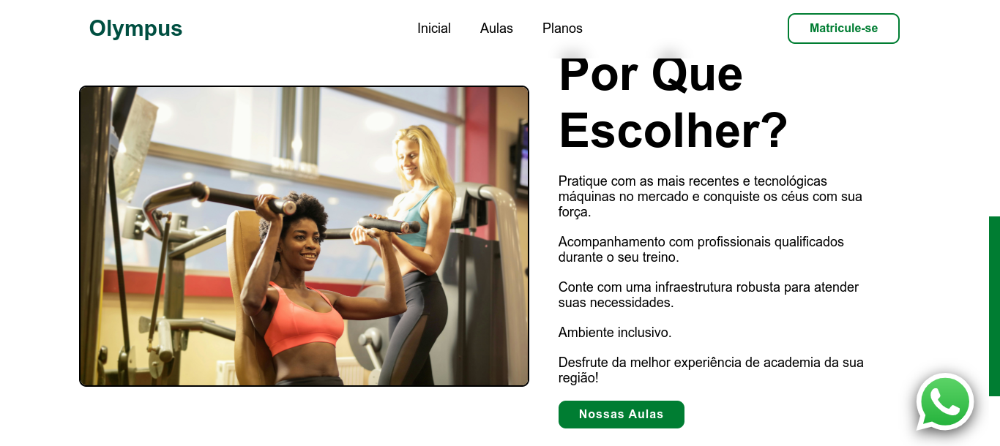
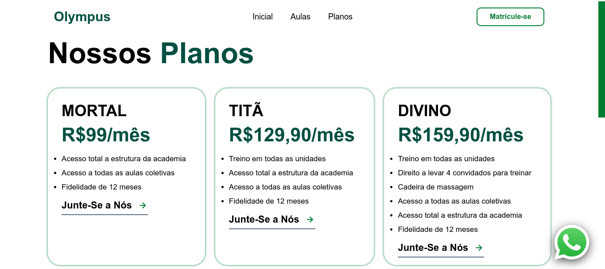
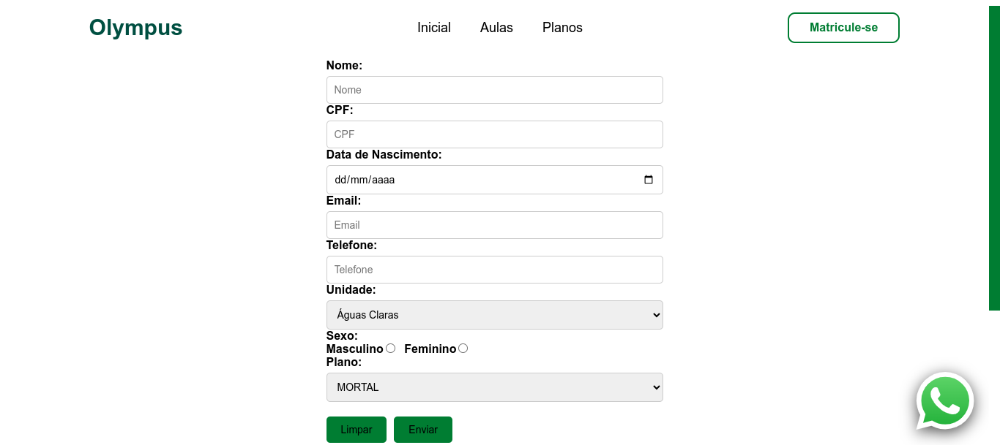

# Olympus — Sistema de Gestão para Academia

> Um projeto web completo desenvolvido em colaboração com colegas da faculdade, combinando um design moderno e responsivo com um backend integrado em PHP e banco de dados MySQL.

---

## 📋 Sobre o Projeto

O **Olympus** é uma plataforma digital voltada para o setor de fitness. O site apresenta a identidade visual da academia, informações detalhadas sobre modalidades de aulas, unidades disponíveis, planos de assinatura e um sistema funcional de cadastro de novos membros integrado ao banco de dados relacional.

---

## 🛠️ Tecnologias Utilizadas

O projeto foi construído utilizando tecnologias web fundamentais, sem dependências de frameworks complexos, garantindo alta performance e facilidade de execução:

* **Frontend:**
  * `HTML5`: Estruturação semântica das páginas.
  * `CSS3`: Estilização avançada com Flexbox, Grid Layout, variáveis CSS (`:root`), efeitos de vidro translúcido (`backdrop-filter`) e design responsivo (Mobile-First / Media Queries).
  * `JavaScript (Vanilla)`: Manipulação de DOM, efeitos dinâmicos de digitação na home, interatividade baseada em cliques nas aulas e planos, e tratamento de comportamento de navegação suave (*smooth scroll*).
  * `Boxicons`: Biblioteca de ícones moderna utilizada nos menus, rodapés e botões de ação rápida.

* **Backend e Banco de Dados:**
  * `PHP`: Processamento do formulário de matrícula e integração com o servidor.
  * `MySQL / MariaDB`: Gerenciamento do banco de dados relacional (`academia_final`).
  * `PDO / MySQLi`: Conectividade e manipulação segura de dados via requisições POST.

---

## ✨ Principais Funcionalidades

1. **Design Responsivo Avançado:**
   * Menu lateral adaptativo para dispositivos móveis (`hamburger menu`).
   * Grade flexível compatível com desktops, tablets e smartphones.

2. **Interatividade Dinâmica:**
   * **Efeito de Digitação (*Typewriter*):** Mensagens rotativas na seção principal (`index.js`).
   * **Cards Interativos:** Expansão de detalhes informativos ao clicar nas seções de aulas.

3. **Sistema de Matrícula Integrado:**
   * Formulário completo recolhendo dados pessoais (Nome, CPF, Nascimento, E-mail, Telefone, Sexo), escolha de unidade e seleção de plano.
   * Validação e persistência automática dos registros na tabela `membros` via PHP.

4. **Ferramenta de Suporte Rápido:**
   * Botão flutuante integrado do WhatsApp posicionado no canto inferior direito de todas as páginas.
